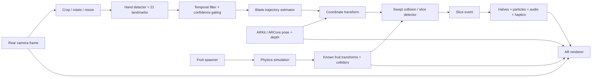

# Building a Mobile AR Fruit-Slicing Game With Vision-Based Hand Gestures

## Executive summary

The technically strongest architecture is **not** to treat the entire experience as a computer-vision object-recognition problem. In the intended game, the fruit is synthetic AR content generated by the game, so its position, velocity, collision volume, and identity are already known exactly by the engine. Computer vision should therefore focus primarily on the **player’s hand**, while virtual-fruit motion and collision remain deterministic game-state operations. A separate fruit detector is useful only if the product scope expands to recognizing or interacting with *real* fruit visible in the camera feed. This distinction eliminates a large amount of unnecessary ML latency and error.

For a first production-quality implementation, the best default stack is **Unity + AR Foundation + ARKit/ARCore + MediaPipe Hand Landmarker**, with hand landmarks feeding a custom temporal “blade” detector. AR Foundation gives a shared iOS/Android abstraction while retaining access to platform capabilities such as camera images, depth, occlusion, light estimation, and tracking. Current Unity documentation lists AR Foundation 6.x for Unity 6, while ARKit and ARCore supply the underlying world tracking and occlusion functionality. citeturn450492search13turn858867search5turn858867search0

MediaPipe is a particularly strong baseline because its mobile hand pipeline uses a palm detector followed by a 21-landmark model, and in video mode reuses prior-frame localization rather than rerunning palm detection on every frame. Google currently reports about **17.1 ms CPU / 12.3 ms GPU pipeline latency on a Pixel 6** for the full Hand Landmarker model, making it much more suitable to this interaction than desktop-oriented systems such as full OpenPose. citeturn220873search0turn220873academia8 OpenPose remains useful as an offline benchmark or annotation aid, but its original architecture targets whole-person multi-keypoint estimation rather than a mobile single-hand interaction loop. citeturn220873search6turn220873search7

The core slicing algorithm should be geometric and temporal rather than a learned “slice gesture” classifier. Construct a blade segment from one or more hand landmarks—typically index fingertip, middle fingertip, or a palm-to-fingertip direction—then sweep that segment between timestamps. Test the resulting swept segment/capsule against each fruit collider. A valid slice should satisfy spatial intersection **and** motion constraints such as minimum screen/world velocity, direction consistency, minimum path length, and a short refractory interval. This gives substantially better control over false positives than recognizing a generic “swipe” class.

A reasonable mobile latency target is **motion-to-visible-effect ≤50–70 ms at the median and <100 ms at p95**, with a stable render rate of **60 FPS on target flagship/mid-range devices** and a 30 FPS fallback tier. Those are engineering targets rather than platform guarantees. MediaPipe’s published Pixel 6 inference numbers already consume roughly 12–17 ms of that budget, so camera buffering, texture conversion, collision logic, and rendering must be carefully pipelined. CameraX explicitly recommends `KEEP_ONLY_LATEST` for real-time analysis when processing cannot keep up, and AVFoundation can discard late frames rather than allowing a stale-frame backlog. citeturn450492search20turn450492search0

For visual realism, **do not perform arbitrary runtime mesh Boolean slicing on every hit in the initial version**. Use pre-authored fruit halves or several prefractured variants, spawn them at the cutting plane, transfer linear/angular momentum, and add juice particles, decals, sound, and screen-space feedback. Unity’s built-in 3D physics uses Nvidia PhysX; Unreal provides Chaos and Geometry Collections for richer runtime fracture, but the latter is heavier than this game requires. citeturn600191search24turn600191search0turn600191search12

On-device inference should be the default. It avoids network dependence and keeps camera imagery local; Apple explicitly describes Core ML as using CPU, GPU, and Neural Engine on device, while Android has deprecated NNAPI since Android 15 and directs developers toward LiteRT/TensorFlow Lite runtimes and GPU acceleration instead. citeturn579793search7turn579793search0 Edge/cloud inference is poorly matched to a continuous action game because network round trips introduce variable latency and send sensitive camera data off-device.

The principal technical risks are not basic fruit physics but **hand-track loss under motion blur, self-occlusion, extreme hand scale, poor lighting, camera/hand coordinate misalignment, stale frames, and false slices caused by landmark jitter**. MediaPipe itself identifies occlusion as a central difficulty, and newer transformer-based methods such as HaMeR improve robustness but are considerably larger and should be viewed primarily as research/offline-teacher candidates rather than the first mobile runtime choice. citeturn220873search1turn499210search0

**Recommended production path:** prototype the interaction with MediaPipe + Unity before training any custom model; validate the slicing mechanic across a broad device matrix; only then decide whether hand segmentation, a custom temporal gesture model, or a more advanced transformer hand model is necessary.

## System architecture and data flow

The system should be designed as two asynchronous pipelines that meet at a timestamped interaction layer: the **vision pipeline** estimates hand state, while the **game pipeline** simulates virtual fruit. Rendering consumes the freshest valid hand state instead of blocking on inference. Camera and ML therefore should not run synchronously inside the render loop.



The key architectural rule is to **timestamp every camera frame, landmark estimate, AR pose, and render frame**. A 20 ms inference result associated with an old camera pose can be visually worse than a slightly less accurate estimate associated with the correct timestamp. On Android, CameraX’s image-analysis APIs explicitly provide backpressure strategies; keeping only the newest frame prevents queues of outdated images. Apple’s `AVCaptureVideoDataOutput.alwaysDiscardsLateVideoFrames` serves a similar purpose, and Apple recommends lowering the capture rate if processing consistently cannot keep up. citeturn450492search12turn450492search20turn450492search7

A practical frame budget for a 60 Hz target is:

| Stage | Planning budget | Design implication |
|---|---:|---|
| Camera acquisition / synchronization | 4–12 ms | Avoid copying full-resolution RGB frames |
| Preprocessing | 1–3 ms | GPU resize/rotation where possible |
| Hand inference | 10–20 ms | Run asynchronously; skip frames when needed |
| Landmark filtering + trajectory | <1 ms | Simple vector math |
| Slice collision tests | <1 ms typical | Virtual fruit positions already known |
| Physics | 1–3 ms | Low body count, simple colliders |
| Rendering / compositing | 5–10 ms | Limit transparency, particles, post effects |
| Total perception-to-effect goal | ~35–70 ms | Measure camera timestamp to presented frame |

These are **engineering budgets, not published platform guarantees**; device-specific profiling must determine the actual thresholds. The only directly published benchmark among these numbers is Google’s current Hand Landmarker Pixel 6 figure of 17.12 ms CPU and 12.27 ms GPU. citeturn220873search0

A second important architectural decision concerns 2D versus 3D interaction. A Fruit-Ninja-like mechanic does **not require metrically accurate 3D hand reconstruction**. Projected 2D fingertip trajectories can be tested against the screen-space projections of known virtual fruit. This is often more robust than trying to infer hand depth from monocular RGB. MediaPipe does output image coordinates and approximate world coordinates, but monocular hand-depth estimation remains intrinsically more ambiguous than 2D keypoint localization. Research systems such as HaMeR and Keypoint Transformer improve 3D reconstruction using substantially richer models and training data. citeturn220873search0turn499210search0turn499210search13

Use 3D hand coordinates only when they materially improve the design—for example, allowing the user to reach “behind” one fruit while avoiding another. Otherwise, screen-space slicing gives lower complexity and fewer failure modes.

## Hand tracking, gesture recognition, segmentation, and fruit perception

### Hand-tracking model choices

| Approach | Output | Mobile suitability | Strengths | Weaknesses | Recommendation |
|---|---|---|---|---|---|
| **MediaPipe Hand Landmarker / BlazePalm lineage** | Palm detection + 21 landmarks, handedness, approximate world landmarks | Excellent | Designed for on-device operation; temporal tracking avoids repeated detection; cross-platform | Can jitter or lose landmarks under blur/occlusion | **Primary runtime choice** |
| **OpenPose hand/whole-body** | Dense 2D body/hand keypoints | Poor–moderate | Mature, interpretable, strong research baseline | Computationally expensive; whole-body pipeline is unnecessary | Offline evaluation/annotation only |
| **HaMeR** | Full 3D hand mesh | Poor for first mobile version | Strong robustness and 3D reconstruction | Large ViT architecture; far more compute than needed | Offline teacher / future premium mode |
| **Keypoint Transformer / A2J Transformer** | 3D hand/keypoint estimates | Research-oriented | Handles hand/object or interacting-hand ambiguity | Not designed as a lightweight turnkey mobile SDK | Research comparison |
| **Temporal transformer models** | Temporally refined 3D pose/action | Research-oriented | Can reduce ambiguity/jitter through temporal context | Adds buffering and compute, raising interaction latency | Avoid initially |

MediaPipe’s production advantage is its explicit two-stage tracking architecture: a palm detector first finds an oriented region, then a landmark model predicts 21 joints; subsequent video frames reuse the previous localization until tracking confidence falls. citeturn220873search0turn220873academia8 Its current bundled hand model was trained on about 30,000 real-world images together with rendered synthetic hands, illustrating that synthetic data already contributes materially to practical hand tracking. citeturn220873search0

OpenPose’s Part Affinity Field formulation was designed for real-time multi-person body pose and later expanded to whole-body pose, including hands. That makes it much broader—and correspondingly less economical—than this game's one- or two-hand problem. citeturn220873search6turn220873search7

Transformer systems should not be dismissed: HaMeR uses a large Vision Transformer and reports substantially stronger robustness across difficult hand imagery, while Keypoint Transformer explicitly targets challenging hand/object interactions. citeturn499210search0turn499210search13 Their main value here is as **accuracy ceilings, offline teachers, or future distilled models**, not as an initial latency-critical runtime.

### Gesture recognition should be mostly algorithmic

The game does not actually need semantic recognition of “open palm,” “victory,” “thumbs-up,” and similar poses. MediaPipe’s canned gesture recognizer supports such classes, but they do not directly encode a fast cutting trajectory. citeturn220873search5

Instead define a virtual blade trajectory. Let the fingertip position at frame \(t\) be \(p_t=(x_t,y_t)\). Compute filtered velocity

\[
v_t = \frac{\hat p_t-\hat p_{t-k}}{t-(t-k)}
\]

where \(\hat p\) is a smoothed landmark position. A slice candidate exists when:

\[
\|v_t\| > v_\min
\]

and the swept fingertip segment from \(\hat p_{t-k}\) to \(\hat p_t\) intersects a fruit’s screen-space circle, capsule, polygon, or projected 3D bounding volume.

A stronger detector uses a **blade segment** rather than one point:

```text
blade_start = index_MCP or palm_center
blade_end   = index_tip
previous_blade = previous frame's segment

swept_region = capsule/quad connecting previous_blade to current_blade

for fruit in active_fruits:
    if swept_region intersects fruit.projectedCollider:
        if speed > threshold
           and trajectoryLength > minimum
           and fruit.cooldownExpired:
              emit Slice(fruit, cutPlane, velocity)
```

This design makes slice detection responsive even when inference runs at 30–45 Hz while rendering is 60 Hz, because collision is performed against the *swept trajectory* rather than only the current fingertip location. The rationale parallels continuous collision detection used in physics engines to prevent fast objects tunneling between discrete frames; Unity’s continuous collision modes similarly sweep fast-moving bodies to detect intermediate impacts. citeturn600191search4turn600191search30

Use a lightweight temporal filter rather than aggressively averaging landmarks. An exponential filter,

\[
\hat p_t = \alpha p_t +(1-\alpha)\hat p_{t-1},
\]

is simple but introduces lag. A velocity-aware One-Euro or Kalman-style filter is preferable when tuning for both low jitter and rapid direction changes. The practical tuning criterion is **slice endpoint error versus added milliseconds of lag**, not smoothness alone.

### Hand segmentation

Hand segmentation is **optional for gameplay** and mostly valuable for visual occlusion: virtual fruit should sometimes appear behind the player's hand rather than always drawing on top. ARKit exposes person-segmentation semantics, but its segmentation class distinguishes *person* versus *none*, not individual hands. citeturn858867search0turn858867search4 Google ML Kit's Selfie Segmentation similarly produces a person foreground mask, and its Android documentation cites approximately 25–65 ms latency on a Pixel 4 depending on image size, which is expensive to add every frame solely for hand occlusion. citeturn716381search0

Therefore use a three-tier strategy:

1. **MVP:** no hand segmentation; render fruit over camera.
2. **Production:** generate an approximate hand occluder from landmarks—capsules along finger bones plus a palm polygon—which costs almost nothing.
3. **High-fidelity mode:** add person/hand segmentation at a lower frequency and temporally warp the mask.

This is preferable to running a segmentation neural network at full camera rate unless user testing proves occlusion realism is essential.

### Fruit detection and tracking

For the normal game, virtual fruits require **no detector or tracker**. Their transforms come directly from the physics engine.

If a later feature allows slicing *real objects*, a mobile detector such as EfficientDet or SSD is more appropriate than a heavyweight detection transformer. EfficientDet was explicitly designed around efficient multi-scale feature fusion and compound scaling; SSD eliminates a separate region-proposal stage. DETR provides an elegant set-prediction transformer formulation but is not the obvious mobile-latency baseline. citeturn521156search0turn521156academia27turn521156academia25

For real-fruit 3D localization, combine the 2D detection with AR depth rather than training a dedicated monocular 3D fruit detector: ARCore’s Depth API fuses depth-from-motion with supported hardware depth sensing and is intended for occlusion and interaction, while ARKit exposes depth/segmentation semantics on compatible configurations. citeturn858867search7turn858867search0

A tracking-by-detection system can associate fruit boxes frame to frame, but this is again unnecessary for virtual objects. Dedicated multi-object trackers add complexity that the engine has already solved exactly.

## AR, physics, collision, slicing effects, and engine choice

### AR framework comparison

| Framework | iOS | Android | Cross-platform code | Depth / occlusion | ML integration | Best use |
|---|---|---|---|---|---|---|
| **ARKit native** | Excellent | No | No | Strong Apple-specific features | Core ML / Vision / Metal | Highest-control iOS build |
| **ARCore native** | Limited/shared APIs | Excellent | No | Depth, planes, light, semantics | LiteRT / MediaPipe | Highest-control Android build |
| **Unity AR Foundation** | Yes via ARKit provider | Yes via ARCore provider | **Yes** | Unified feature APIs where providers support them | C#/native plugins/MediaPipe | **Recommended cross-platform game stack** |
| **Unreal Engine AR** | Yes | Yes | Yes | ARKit/ARCore unified layer | C++ / plugins | High-end rendering, heavier pipeline |

ARKit’s world-tracking configuration supports frame semantics such as person segmentation and segmentation with depth, though Apple explicitly warns that additional AR features consume compute and energy and should be enabled selectively. citeturn858867search0 ARCore supplies surface understanding, depth, light estimation, anchors, and related environmental features. citeturn858867search5turn858867search7

Unity AR Foundation is the pragmatic choice because it gives a shared API over ARKit and ARCore and exposes camera images and occlusion subsystems. Unity 6 currently documents AR Foundation 6.x, including camera, object tracking, depth, body tracking, and people-occlusion capability flags where the underlying provider supports them. citeturn450492search13turn858867search11

Unreal provides a unified handheld AR path as well, and current Unreal documentation lists ARKit and ARCore support plus Chaos physics/destruction. citeturn858867search8turn858867search10 It becomes attractive if photorealistic rendering is a priority, but for a lightweight mobile arcade game Unity generally yields a smaller integration surface for AR + mobile CV.

### Fruit physics

A fruit should be a rigid body with:

- initial position sampled from a spawn region;
- initial upward/lateral velocity;
- angular velocity;
- gravity;
- simple sphere/capsule/convex collision geometry;
- despawn threshold below camera view.

Unity’s built-in 3D physics integrates Nvidia PhysX and supports rigid bodies, colliders, and continuous collision modes. citeturn600191search24turn600191search7 Keep fruit colliders simple because the rendered mesh does not need to equal the collision geometry; Unity explicitly separates visual geometry from collider geometry. citeturn600191search13

To make motion visually convincing, add randomized spin, slightly different mass and drag by fruit type, and a curved launch distribution. These are artistic parameters rather than ML problems.

### Slicing implementation options

| Technique | CPU/GPU cost | Visual quality | Authoring effort | Mobile recommendation |
|---|---:|---:|---:|---|
| Swap whole fruit → two pre-authored halves | Very low | Good | Low | **Best MVP** |
| Multiple pre-cut variants selected by angle | Low | Very good | Moderate | **Best production compromise** |
| Runtime plane/mesh Boolean cut | Medium–high | Excellent when correct | High | Only if arbitrary cuts are essential |
| Destruction/fracture system | High | Excellent | High | Usually overkill |

A believable cut requires the **cut plane** to be derived from the blade path. In 2D gameplay, the screen-space slice line defines orientation; transform that line into object-local coordinates and select the nearest pre-authored split variant. Spawn the halves with:

\[
v_1 = v_f + \lambda n + \eta_1,\qquad
v_2 = v_f - \lambda n + \eta_2
\]

where \(v_f\) is the fruit velocity and \(n\) is the cut-plane normal. This preserves fruit momentum while pushing the halves apart.

Unreal’s Chaos Geometry Collections support authored fracture and slice-fracture operations and can trigger breaking from collision/strain. citeturn600191search12turn600191search20 That is useful for a visually ambitious Unreal version, but a fruit game with perhaps 5–20 active bodies gains little from general-purpose destruction simulation.

The perceptual payoff comes largely from synchronized effects: visible cut, juice spray, sound, haptic impulse, score animation, and temporary blade trail. These should fire from the *same slice event*, ensuring feedback feels causally instantaneous.

## Mobile camera pipeline, ML deployment, and performance optimization

### iOS pipeline

A native iOS path is:


AVFoundation exposes video pixel buffers directly through `AVCaptureVideoDataOutput`, and its late-frame-discard behavior is explicitly intended to avoid processing queues when the delegate falls behind. citeturn450492search4turn450492search0 In a Unity AR Foundation implementation, prefer provider camera textures or acquired CPU images only when necessary; avoid round-tripping camera images through PNG/JPEG, `Texture2D`, or managed arrays.

For custom models, Core ML can schedule execution over CPU, GPU, and Apple Neural Engine, and Apple provides quantization, pruning, and palettization tools. citeturn579793search7turn579793search6 Metal Performance Shaders offers optimized GPU kernels, while newer Metal ML workflows can place inference and rendering work in the same GPU timeline in supported Metal 4 configurations. citeturn579793search2turn579793search8

### Android pipeline


CameraX `ImageAnalysis` supports explicit backpressure; Google recommends `STRATEGY_KEEP_ONLY_LATEST` for streaming ML when an analyzer can be slower than frame production. citeturn450492search12turn450492search20 ML Kit similarly recommends dropping camera frames while a detector is busy instead of queueing them. citeturn716381search0

Do **not** design a new Android architecture around NNAPI. Google deprecated NNAPI in Android 15 and recommends migration toward TensorFlow Lite/LiteRT runtimes and GPU acceleration. citeturn579793search0turn579793search1

### Deployment comparison

| Deployment | Latency | Offline | Privacy | Device load | Backend cost | Recommendation |
|---|---|---|---|---|---|---|
| **On-device** | Lowest/predictable | Yes | Best | Highest | None | **Default** |
| Edge server | Network-dependent | No | Camera leaves device | Lower local ML | Ongoing | Only for optional advanced features |
| Cloud | Highest/variable | No | Most sensitive | Low local ML | Highest | Unsuitable for core slicing loop |
| Hybrid | Local core, remote optional | Core works offline | Configurable | Moderate | Moderate | Good for analytics/model updates |

Core ML’s own rationale for on-device execution includes responsiveness, offline availability, and keeping user data local. citeturn579793search7 Android documentation describes analogous latency, availability, privacy, and server-cost advantages for on-device inference. citeturn579793search1

### Optimization order

Optimize in this order because each step preserves more quality than immediately shrinking the model:

1. **Eliminate unnecessary work.** Do not detect virtual fruit; do not segment every frame unless necessary.
2. **Run hand inference asynchronously.**
3. **Process only the newest frame.**
4. **Reduce ML input resolution while retaining enough pixels on the hand.**
5. **Exploit region-of-interest tracking** after initial detection.
6. **Use FP16 / INT8 quantization where supported.**
7. **Profile GPU versus CPU/ANE/NPU paths.**
8. **Prune or distill only after profiling demonstrates a model bottleneck.**

Apple explicitly supports lower-precision Core ML weights, pruning, quantization, and palettization. citeturn579793search5turn579793search6 TensorFlow Lite/LiteRT exposes post-training optimization and sparse/pruned model paths. citeturn716381search13

A key warning is that “GPU = faster” is not universally true. Preprocessing, tensor copies, delegate setup, rendering contention, and model operator support can erase theoretical acceleration. Measure **camera timestamp → inference completion → displayed feedback**, not inference time alone.

## Data, annotation, privacy, UX, accessibility, and evaluation

### Dataset strategy

If MediaPipe meets accuracy targets, **no custom hand-training dataset is required for MVP**. The first dataset effort should instead build a *game-specific evaluation corpus* containing realistic gameplay failures.

Recommended evaluation dimensions include:

| Axis | Required variation |
|---|---|
| Skin appearance | Broad skin-tone coverage |
| Hands | Left/right, one/two hands, hand sizes |
| Pose | Open hand, pointing, bent fingers, partial fists |
| Motion | Slow → very fast slices |
| Visibility | Partial frame entry/exit, self-occlusion |
| Lighting | Indoor warm/cool, backlight, low light |
| Background | Plain, cluttered, skin-colored objects |
| Camera | Different FOVs, front/rear orientation where supported |
| Device | Low/mid/high tier iOS and Android |
| Accessories | Rings, watches, sleeves; optionally gloves |
| Blur | Low-light and fast-motion blur |

Public datasets provide useful pretraining and evaluation diversity. FreiHAND focuses on RGB hand pose and shape; InterHand2.6M provides very large-scale interacting-hand imagery; later egocentric datasets such as AssemblyHands focus on difficult hand/object interactions. citeturn491037search0turn491037search32turn491037search12

If a custom landmark or segmentation model becomes necessary, annotate:

- 21 hand keypoints;
- per-keypoint visibility/occlusion;
- handedness;
- hand bounding box;
- optional pixel mask;
- timestamped slice intent for temporal evaluation.

Do not label “slice” purely from appearance. Record temporal trajectories and define ground truth using the intended collision rule, because a stationary hand overlapping fruit should **not** count as a slice.

Synthetic data can cheaply provide exact landmarks, segmentation masks, camera parameters, depth, and occlusion labels. Domain randomization intentionally varies textures, lighting, pose, background, and related rendering parameters to improve transfer beyond the synthetic domain. citeturn491037academia34turn491037academia40 However, recent hand-pose research continues to report a synthetic-to-real gap, so synthetic data should augment rather than replace real gameplay validation. citeturn491037search5

### Privacy and permissions

The game inherently requires camera access. iOS requires an `NSCameraUsageDescription`; Android requires the camera permission declaration and runtime permission flow. citeturn163966search25turn163966search27turn163966search21 Android 12 and later expose camera-use privacy indicators and privacy-dashboard visibility. citeturn163966search21turn163966search23

The strongest privacy design is:

- process hand video entirely on device;
- never store raw camera frames by default;
- log only non-image telemetry such as frame time, detection confidence, hit/miss status, and anonymous device performance tier;
- make diagnostic video collection a separate explicit opt-in;
- give the game a graceful permission-denied screen explaining why camera access is essential.

Apple also restricts use of data obtained from camera/depth/facial-mapping technologies for advertising or use-based data mining. citeturn163966search22

### UX and “visual presence”

The hand must feel like a reliable physical controller even if no hand mesh is rendered. The player needs three continuously legible cues:

- **Tracking presence:** a subtle blade trail or fingertip glow appears only when confidence is sufficient.
- **Interaction readiness:** trail intensity/shape changes when velocity crosses the slice threshold.
- **Impact confirmation:** fruit split, sound, haptic, particle burst, and score appear immediately from the same event.

Avoid drawing the full 21-landmark skeleton in production unless it is part of the aesthetic; it makes tracking noise visually obvious.

For calibration, do not require a long setup procedure. Show a short first-run prompt asking the player to place a hand in view and perform one broad swipe. Use this to estimate comfortable hand scale, threshold velocity, and valid play region.

AR UX also needs fatigue controls. Apple’s AR guidance recommends limiting fatigue and providing downtime, while its motion guidance warns against excessive or unnecessary motion. citeturn163966search4turn163966search0 Short rounds are therefore preferable to continuous multi-minute arm waving.

### Accessibility

A strict “hand gestures only, no touch or keyboard” gameplay requirement inherently excludes users unable to perform the required arm/hand motion. That should be treated as a product constraint, not concealed as an ML issue.

Within that constraint, provide:

- one-hand mode;
- selectable left/right hand;
- reduced required movement amplitude;
- adjustable slice-speed threshold;
- seated-play framing;
- high-contrast fruit/blade options;
- color-independent bomb/fruit differentiation;
- optional audio/haptic confirmations;
- reduced particles/flashes;
- reduced motion mode;
- longer response windows or slower fruit speeds.

Apple’s accessibility guidance specifically recommends responding to Reduce Motion and reducing repetitive/peripheral motion; Android similarly recommends that user flows have accessible alternatives where possible. citeturn163966search1turn163966search13turn163966search45 If the “gesture-only” requirement is absolute, alternative input can still be offered as a separate accessibility mode without altering the main game mode.

### Evaluation metrics

Do not use a single “accuracy” number. Evaluate the system at four layers.

| Layer | Metric | Suggested release target* |
|---|---|---:|
| Hand detection | Hand presence recall | ≥98% in supported conditions |
| Landmark | normalized fingertip error / PCK | Establish per-device baseline |
| Stability | fingertip jitter while stationary | <1–2% of screen width RMS |
| Slice detection | precision | ≥99% |
| Slice detection | recall | ≥97% |
| Interaction | false slices | <1 per 5 min play |
| Interaction | miss rate on deliberate slices | <3% |
| Latency | camera-to-visible-effect median | ≤50–70 ms |
| Latency | p95 | ≤100 ms |
| Rendering | frame rate | 60 FPS target / 30 FPS fallback |
| Thermal | sustained performance | No progressive collapse during full session |
| Power | battery drain | Measure by device tier |

\*These are proposed engineering acceptance targets, not standards or vendor guarantees.

Measure latency with timestamp instrumentation, preferably corroborated using high-speed external video: show an LED or screen event corresponding to input motion and measure the first visible split frame. Software timers alone often omit camera exposure, display scanout, and buffering.

For slice detection, report a confusion matrix:

\[
Precision = \frac{TP}{TP+FP}, \qquad
Recall = \frac{TP}{TP+FN}
\]

False positives deserve more weight than occasional misses because an unexplained fruit exploding without a deliberate gesture destroys the causal relationship between hand motion and game response.

## Recommended implementation roadmap, testing plan, risks, and resources

The following effort estimates are **planning estimates**, assuming a small experienced team, existing 3D fruit assets, no multiplayer, and no custom ML training during the initial prototype. Platform targets and minimum supported devices were unspecified, so device coverage materially affects schedule.

| Milestone | Deliverable | Planning effort | Exit criterion |
|---|---|---:|---|
| **Interaction proof** | Camera + one-hand landmarks + virtual fruit + basic slice | 1–2 engineer-weeks | Deliberate swipe slices reliably on one iOS and one Android device |
| **Core game prototype** | Spawn loop, physics, scores, bombs, halves, FX/audio | 2–4 weeks | Playable 2–3 minute session at stable frame rate |
| **Cross-platform AR** | AR Foundation integration, coordinate transforms, device rotation handling | 2–3 weeks | Matching gesture behavior across iOS/Android |
| **Robustness pass** | Filtering, confidence gating, swept collision, frame dropping | 2–4 weeks | False-slice/miss targets met on internal corpus |
| **Visual production** | Better slicing variants, particles, hand occlusion approximation, lighting | 2–4 weeks | Visual-quality bar met |
| **Optimization** | Profiling, FP16/INT8 experiments, thermal testing | 2–4 weeks | Sustained performance on target tiers |
| **Accessibility/privacy** | Settings, permission UX, telemetry design | 1–2 weeks | Accessibility and privacy review complete |
| **Device certification** | Broad matrix + regression automation | 3–6 weeks | Release thresholds met |

A credible first release is therefore roughly **3–5 calendar months for a focused 3–5 person team**, assuming no custom model training and ordinary game-production polish. A sophisticated arbitrary-mesh slicing system, bespoke transformer hand model, extensive backend, or very broad Android compatibility can substantially increase that figure. This is an engineering estimate, not a sourced industry average.

A compact team can consist of one gameplay/Unity engineer, one mobile/AR engineer, one technical artist, and part-time QA/ML support. A more robust production team would add a dedicated computer-vision/ML engineer and device QA engineer.

The recommended software stack is:

| Component | Preferred option | Alternative |
|---|---|---|
| Engine | **Unity 6 + AR Foundation** | Unreal 5.8 / native |
| iOS AR | ARKit provider | Native ARKit |
| Android AR | ARCore provider | Native ARCore |
| Hand landmarks | **MediaPipe Hand Landmarker** | Custom Core ML/LiteRT model |
| ML runtime iOS | MediaPipe / Core ML | Metal/MPS |
| ML runtime Android | MediaPipe / LiteRT GPU | CPU fallback |
| Physics | Unity PhysX | Unreal Chaos |
| Occlusion | Landmark-derived hand geometry | ARKit person segmentation / ML segmentation |
| Custom detector, if real fruits needed | EfficientDet/SSD family | Mobile DETR variant |
| Profiling | Unity Profiler + Xcode Instruments + Android GPU/CPU tools | Platform-native profilers |

MediaPipe is open source and provides the most directly relevant pretrained hand-landmark pipeline. citeturn220873search1turn220873search2 EfficientDet and DETR both have published reference implementations/models associated with their original work, though they should not be included in the normal virtual-fruit path. citeturn521156search0turn521156academia25

The testing pyramid should begin with deterministic algorithm tests: feed prerecorded landmark trajectories into the slice detector and verify exact hit/miss behavior. Next run prerecorded camera videos through the vision stack and compare landmark stability and expected slice events. Then execute hardware tests across device tiers, followed by adversarial human testing under difficult backgrounds, illumination, hand occlusion, and fast motion.

The highest-priority risks and mitigations are:

| Risk | Likelihood | Impact | Primary mitigation |
|---|---|---|---|
| Fast-hand motion blur | High | High | Brightness guidance, high shutter/FPS where possible, swept collision |
| Landmark jitter causes phantom cuts | Medium | High | Temporal filtering + speed/path thresholds + confidence gating |
| Hand temporarily lost | High | Medium | Reuse trajectory briefly; suppress slicing during reacquisition |
| Inference queue creates stale input | Medium | High | Latest-frame-only backpressure |
| Coordinate transform bugs | Medium | High | Automated orientation/aspect-ratio calibration tests |
| Thermal throttling | Medium | High | Dynamic inference/render quality tiers |
| Segmentation too expensive | High if enabled | Medium | Landmark-derived occluder |
| Android device fragmentation | High | High | Explicit minimum tier + device lab |
| Model bias/generalization gaps | Medium | High | Diverse evaluation corpus + error slicing by conditions |
| Permission rejection | Medium | High | Clear explanation and graceful blocked state |
| Arbitrary mesh cuts exceed budget | Medium | Medium | Pre-authored cut variants |

The most important milestone is **not** training a better ML model. It is demonstrating that the complete camera → landmark → trajectory → collision → visible feedback loop remains low-latency and predictable across real devices. MediaPipe already supplies a mobile-grade hand model with temporal tracking and measured Pixel 6 latency; ARKit, ARCore, and AR Foundation already provide the AR camera/world infrastructure; Unity or Unreal already provide mature rigid-body simulation. citeturn220873search0turn858867search0turn858867search5turn450492search13 The project’s differentiating engineering work should therefore concentrate on **temporal hand filtering, robust swept slice detection, coordinate synchronization, compelling cut feedback, and exhaustive device-level latency testing** rather than replacing solved components prematurely.